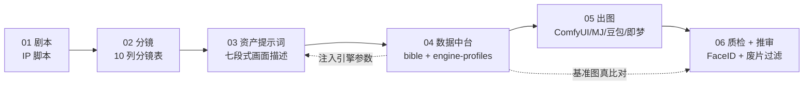
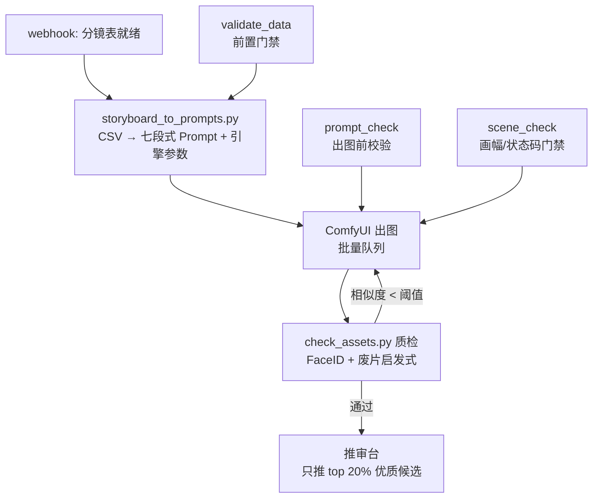

# video-skill · AI 短剧生产流水线 Skill 体系

> 从 IP 剧本到成片审片的**六层可重复、可验证、可交接**的生产级工作流。
> 核心信条：**生产级 = 可重复 + 可验证 + 可恢复 + 可观测 + 可扩展 + 可交接**。

[](LICENSE)
[](https://www.python.org/)

[](https://codecov.io/gh/jhb-0212/video-skill)

---

## 这是什么

一套面向 **AI 短剧 / 竖屏剧**批量生产的 skill 体系，把「靠人肉堆、靠经验、靠运气」的出图流程，改造成「数据中台 + 脚本自动化」的工业流水线：

- **01～04 是方法论层**（调度 → 剧本 → 分镜 → 资产提示词），沉淀的是「怎么把戏拆对、把画面写准」的领域知识；
- **05 是数据中台**（bible 基准库 + 引擎参数 + 分集数据），是「唯一可信的数据源」；
- **06 是脚本层**（校验 / 派生 / 质检 / 编排），是「把门禁机器化」的执行器。

一句话：**脚本保证「不出错」（锁脸、不换脸、焦段对、负面词齐、引擎参数从后端注入），美术保证「出好图」（挑风格、补氛围）。**

## 核心设计（为什么能「生产级」）

| 机制 | 解决什么问题 | 落地 |
|---|---|---|
| **前后端解耦** | 换引擎要改每张提示词 | 前端七段式只写「画面长什么样」，引擎参数（采样器/CFG/负面词）全部剥到 `engine-profiles/`，换引擎只改 profile |
| **CSV 权威源 + JSON 派生物** | 双份数据漂移 | CSV 是唯一人工编辑入口，JSON 由 `csv2json.py` 机械派生（带 `_source_hash`），字段级严格相等校验 |
| **存 ID 铁律** | 名字改了引用断 | `characters` / `assets_required` / `object_positions` 一律存 ID（`CHAR-xxx` / `PR-xx` / `SC-xx`），不存名字 |
| **三对象场景模型** | 场景「能不能用」说不清 | `Scene`（基准）/ `SceneState`（SS0-SS5 状态码）/ `SceneReadiness`（可用性门）分离 |
| **画幅三层铁律** | design plate 误用竖版 | design plate 16:9 横版 → blocking ref 9:16 竖版 → 成片 9:16 |
| **JSON Schema 机读契约** | 字段规范靠人背 | 8 份 schema 机读校验，外键/唯一性/枚举/必填机器把关 |

架构决策的来龙去脉见 [`ADR.md`](ADR.md)。

## 全链路





## 快速上手

```bash
# 1. 全量数据校验（前置门禁）
cd 06-scripts
python validate_data.py all ../05-data-center

# 2. 分镜表 → 提示词（CSV 权威源 → 七段式画面描述 + 引擎参数注入）
python storyboard_to_prompts.py "../05-data-center/episodes/EP001_storyboard.csv" "../05-data-center/bible" "EP001" --engine comfyui

# 3. 出图前编译期校验（挡废片在出图前）
python prompt_check.py out/EP001_prompts.json "../05-data-center/bible" --engine comfyui

# 4. 出图后质检（FaceID 真比对 + 废片启发式过滤）
python check_assets.py "../05-data-center/episodes/EP001_assets.csv" "../05-data-center/bible" "../05-data-center/versions" --profile "../05-data-center/quality-profile.json"

# 或一条命令跑全程（dry-run 预览）
python pipeline_runner.py --episode EP001 --engine comfyui --dry-run

# 跑测试
python run_tests.py    # 50 用例
```

> 完整操作手册见 [`06-scripts/README.md`](06-scripts/README.md)，编排对接（N8N/Coze）见 [`06-scripts/orchestration.md`](06-scripts/orchestration.md)。

## 目录结构

```
video-skill/
├── 01-pipeline-orchestrator/   # 调度层：总调度 / 路由表 / 字段契约
├── 02-ip-script/               # 剧本层：阶段 A/B/C + 经济性 + 交付包
├── 03-storyboard/              # 分镜层：分镜表 10 列标准
├── 04-asset-prompts/           # 资产层：七段式提示词 + 参考图权限隔离
├── 05-data-center/             # 数据中台：bible + engine-profiles + episodes
├── 06-scripts/                 # 脚本层：校验 / 派生 / 质检 / 编排（50 测试）
├── .github/workflows/ci.yml    # CI：lint → test → schema → dry-run
├── Dockerfile / Dockerfile.gpu # 容器化（基础 / GPU 变体）
├── ADR.md                      # 架构决策记录
├── RUNBOOK.md                  # 运维手册（故障处理）
├── GOVERNANCE.md               # 权限矩阵 + 备份恢复 + 敏感数据
├── SOURCE.md                   # 来源与授权登记
├── CHANGELOG.md                # 变更记录（breaking 标注）
└── LICENSE                     # MIT
```

完整目录树见 [`PROJECT_STRUCTURE.md`](PROJECT_STRUCTURE.md)。

## 多引擎支持

前端七段式画面描述与引擎无关，后端控制台 `05-data-center/engine-profiles/` 已内置：

| 引擎 | 文件 | 说明 |
|---|---|---|
| ComfyUI / SD | `comfyui.json` | 采样器 / CFG / 步数 / 尺寸 + 英文负面词 |
| Midjourney | `midjourney.json` | `--ar` / `--style` / `--cref` + 权重语法 |
| 豆包 | `doubao.json` | 中文负面词 |
| 即梦 | `jimeng.json` | 中文负面词 |
| MiniMax H3 | `minimax_h3.json` | 中文负面词 |

换引擎 = 换 `--engine` 参数，前端画面描述一字不动。

## 质量门禁

| 门禁 | 级别 | 挡住什么 |
|---|---|---|
| `validate_data` | 前置 | 外键缺失 / asset_id 重复 / 缺列 / 枚举非法 |
| `prompt_check` | 出图前 | 引擎参数越界 / 文字政策矛盾 / 命名越权 |
| `scene_check` | 出图前 | 画幅违规 / 状态码非法 / 连续性断裂 / 可用性缺失 |
| `check_assets` | 出图后 | FaceID 相似度 < 阈值 / 废片 / 场景画幅违规 |

阈值统一收敛在 `05-data-center/quality-profile.json`，换项目/集数只改这一处。

## 开源协议

[MIT](LICENSE) © 2026 jhb-0212

> 方法论来源与授权登记见 [`SOURCE.md`](SOURCE.md)（scene-design MIT / short-drama-image-prompts）。
